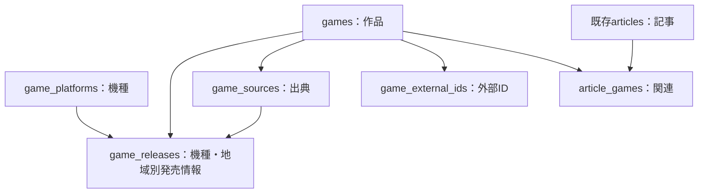

# 第2フェーズ：作品データベース

## 調査結果（2026-11-01 JST）

対象：GitHub `ilovegame-gamenow/ilovegame`、main `eaaa0d7`。
Supabase：`I LOVE GAME♪` (`hsckhzwdtpvzylwakhdq`)、PostgreSQL 17、ACTIVE_HEALTHY。

- ベーステーブルは `articles`、`article_drafts`、`site_settings` の3つ。すべてRLS有効。
- 記事は73件、調査時の掲載状態は55件。これは `status=published` の数で、公開ビューの表示件数とは異なる。
- 全記事の `game_title` はNULL、`platforms` は空。作品マスター・発売情報・作品外部IDは未実装。
- 公開APIは `published_articles` ビューを使用。本文等の必須項目と生成状態を判定して公開する。
- 編集室は独自Cookieをサーバーで検証し、秘密キーでDBにアクセスする。Supabase Authのauthenticatedと編集者は同義ではない。
- 収集は `news-sources` と各collector、登録は `article-queue-repository` に集約。
- 評価・生成・掲載判断は既に分離されている。`news-processor` に作品登録を混ぜない。
- mainの直近Testsは成功。ローカルの既存79テストも成功。
- 既存SQLは `database/*.sql` で管理されている。本番migration履歴には設定関連4件があるが、記事・下書きの初期定義は含まれない。新しい空DBで全機能を再現する基盤は別途必要。

本番は読み取り調査のみ。この変更ではデプロイ・DB変更・記事更新を行わない。

## 最初に実装する範囲

`database/game-catalog.sql` はレビュー待ちの追加DDL。適用前に確認が必要。
既存テーブル・公開ビュー・ポリシー・API・画面・定期収集は変更しない。
作品DB用のテーブルと制約、権限、機種の初期値だけを用意する。

| テーブル | 責任 |
| --- | --- |
| games | 作品の共通ID、名称、紹介文、作品の公開状態 |
| game_platforms | メーカーと分離した機種コード |
| game_releases | 作品×機種×地域×通常版／早期アクセスごとの発売情報 |
| game_sources | 作品に関する情報源URL、確認状態、確認日時、確認メモ |
| game_external_ids | Steam App ID等から同じ作品を識別する外部ID |
| article_games | 記事と作品の多対多の関連 |



作品は記事がなくても存在できる。1記事で複数作品を扱え、1作品に複数記事を関連づけられる。
既存 `articles.game_title/platforms` は互換用として残す。新しい作品の正本はgamesとgame_releases。
リメイクは別作品、同一作品の機種移植は同じ作品の別発売情報とする。判断できない版・DLC・バンドルは自動統合しない。

### 発売日の扱い

- 日付は `date`。記事の公開日時 `timestamptz` と混ぜない。
- `day` は確定日、`month` は月初、`year` は年初を検索用の値として持ち、必ず精度と一緒に扱う。
- 「2027年春」「未定」は `unknown`＋日付NULL＋`release_label`。架空の日付に変換しない。
- `release_label` は原文の補足。確定日表示では構造化日付を優先する。
- 日別カレンダーは `day` のみ。月表示ではdayとmonthを分け、「今月発売日確定」と「今月予定」を混同しない。yearは月別一覧に混ぜない。
- JPとWWは別データ。WWから日本発売を推測しない。
- 延期・中止は状態を変更し、日別カレンダーから除外。新日程未定の延期は日付NULL／unknownにする。
- 早期アクセスと正式発売は別行。ストアの版違いは外部IDで同じ作品に結びつけられる。
- 公開時は作品の公開状態、発売情報のverified_at、出典のverified状態をすべて確認する。出典が後で却下された情報も除外する。

### 重複と情報の信頼性

タイトルは一意にしない。同名作品・和英名・リメイクを誤統合するため。
まず `(provider, external_id)` の完全一致で同定し、タイトル類似は編集者への候補提示に使う。
別表記の照合や複数ストアからの同一作品判定は、次の候補審査段階で実装する。
出典URLは同一作品内で一意。発売情報の出典は同じ作品に所属することを複合外部キーで保証する。
出典の確認と、そのページから読み取った発売情報の確認は別に記録する。
今回の出典メモは完全な変更履歴の代替ではない。AIによる継続更新を開始する前に、候補・主張・採用前後の値を記録する仕組みを追加する。

### 権限と互換性

最初は新6テーブルをサーバー専用とする。RLS有効、PUBLIC/anon/authenticatedの権限を明示的に取り消し、service_roleに必要なCRUDのみ付与。
独自編集室ログインをSupabase Authとして扱うポリシーは作らない。
公開読み取りは、後のAPI実装で公開可能な列・条件を決めてから追加する。
既存記事へのトリガーや自動移行は追加しない。新機能の不具合を既存収集・記事生成へ波及させない。

## 段階的な実装順序

1. 今回：作品DBの設計、追加SQL、隔離したPostgreSQLで制約・権限を検証。PRでレビュー。本番適用は未実施。
2. 編集室で作品を手動登録・確認する最小導線。認証はrequireEditorを再利用、作品データアクセスを専用repositoryに集約。既存記事との関連づけも同じ層で扱う。
3. AI発見候補の保存・重複候補提示・採用処理。候補には取得URL、取得時刻、抽出した主張、根拠、モデル/プロンプト版、確認状態を持たせる。採用時に作品・出典・外部ID・発売情報をトランザクションで登録する。
4. 発見した話題を既存の記事登録・評価・生成エンジンへ渡す。作品登録のために記事を強制作成しない。掲載点数と作品の確認状態を連動させない。
5. 発売カレンダー・今月発売・注目作品を共通の作品取得層から表示。注目作品の選定は記事importanceと独立させ、選定理由・期間を持つ関連表を必要時に追加する。

次の段階へ進むごとに既存テストと追加テストを実行する。本番DB反映・mainへのマージ・公開デプロイはユーザー確認後。
AIリサーチャーの定期実行・新たなAPI利用や課金は今回開始しない。

## 適用と復旧の手順

適用直前にmainと本番スキーマを再照合し、同名テーブルが未作成か確認する。
確認後に `game_catalog_foundation` としてSupabaseのapply_migrationでSQLを1回適用し、migration履歴とテーブル・権限を再照会する。
DDLはトランザクション内で実行するため、途中失敗は全体をロールバックする。
成功後の復旧は既存側を維持して新機能を停止するのが基本。作品データが入った後にテーブルを安易にDROPしない。
初期適用直後で空の場合のみ、別途レビュー済みの逆DDLで追加物を削除できる。既存3テーブルには触れない。

## 検証

```sh
node --test tests/*.test.mjs
# 専用の空PostgreSQL DBでのみ実行（本番DBで実行しない）
psql "$TEST_DATABASE_URL" -X -v ON_ERROR_STOP=1 -f tests/database/game-catalog.sql
```

DBテストは専用DBに最小のarticlesと役割を作って新SQLを適用する。既存本番スキーマ全体の再現ではない。
制約・ロール権限・RLS・更新日時・既存記事維持を検証する。新しいAPIや公開画面はこの段階ではまだ接続しない。

初回実装時の結果：既存79テスト成功。DBテストはPGlite 0.5.14（PostgreSQL 18.6）でSQLを文単位に実行して成功。
一時的な検証用依存のみを使用し、アプリの依存は追加していない。
本番と同じPostgreSQL 17での検証は、追加したGitHub Actionsの隔離DBジョブで行う。ブランチ送信前のため未実行。
本番への適用は、このCI成功と改めてのユーザー確認を条件とする。
